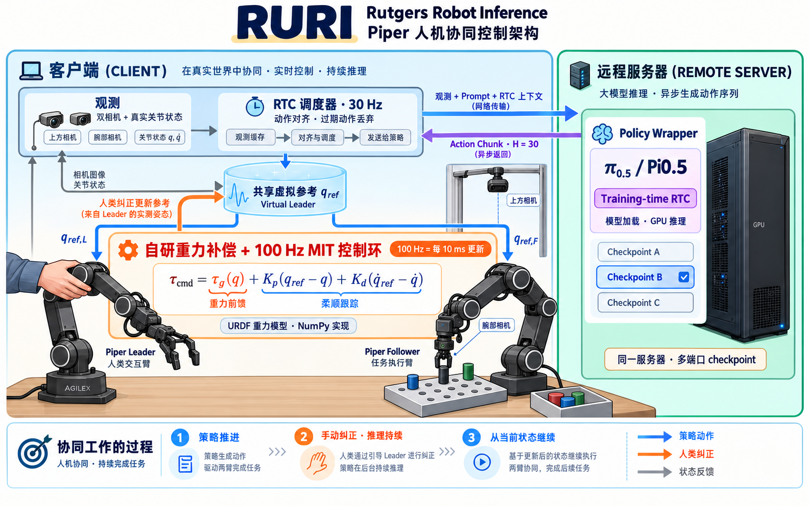

# RURI 核心架构：双 Piper 人机协同

这张图展示 RURI 的双 Piper 共享虚拟参考控制路径。物理 leader 是人的交互入口；policy 经异步调度后更新共享参考，并行驱动 leader 和 follower。人类修正会更新参考并使旧轨迹失效，策略继续基于最新状态推理。

客户端负责相机与关节观测、默认 30 Hz 的 RTC 动作调度，以及本地 100 Hz MIT 控制环。服务器负责 Policy Wrapper、模型加载和 GPU 上的异步动作 chunk 推理。图中的 Pi0.5 training-time RTC 和 H=30 对应当前服务配置。

重力补偿与阻抗控制的示意式为：

\[
\tau_{cmd}=\tau_g(q)+K_p(q_{ref}-q)+K_d(\dot q_{ref}-\dot q).
\]

新 shared-reference 实现向 MIT 提交积分后实际应用的 reference velocity；固定增益、重力前馈、位置跟踪和阻尼共同作用。图中公式用于说明控制组成，实际执行保留扭矩、关节范围、跟踪误差和通信看门狗约束。共享参考不等于两臂实测位置逐点相同。

图保留了原双臂共享参考和早期 RTC 示例。圆圈入口现在使用平滑重力交接：确认介入后卸掉右臂
阻抗，纯重力阶段按关节运动窗口判断静止，再恢复 policy。新双臂圆圈入口复用此交接机制，
在右臂完全进入重力模式后，左臂用 0.5 秒从共享 reference 插值到右臂实时读数；恢复时从
左臂最后已发目标重新建立共同 reference。左臂保留原 single Piper 的固定 Kp/Kd 和重力前馈，
右臂可卸载阻抗进入纯重力拖动。
调度器只负责推理，交接和插值由 MIT worker 执行。控制公式与入口见 [实现说明](piper-shared-reference.md)。

实现参考：[共享参考](../src/ruri/client/controllers/single_piper_assisted/control.py)、[双臂 MIT 循环](../src/ruri/client/controllers/single_piper/mit/assisted.py)、[重力模型](../src/ruri/client/controllers/single_piper/mit/gravity.py)、[RTC 调度](../src/ruri/client/schedulers/assisted.py)。

使用内置 image_gen 生成。[初版提示词](assets/ruri-core-architecture-cartoon.prompt.txt)、[最终版修订提示词](assets/ruri-core-architecture-cartoon.refinement.txt)。
